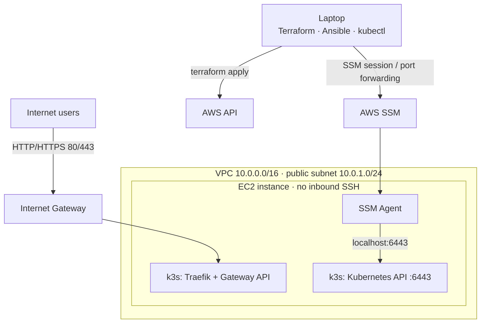

# aws-k3s-platform

Self-hosted Kubernetes (k3s) platform on AWS, provisioned with Terraform and configured with Ansible. No SSH and no open management ports: all access goes through AWS SSM.

## Architecture



## Design decisions

- **No SSH, access via SSM:** With SSH, every user's key has to be added to each server, and a leaked private key gives anyone access. SSM replaces this with a single entry point controlled by IAM: no inbound management port is open, every session is logged in CloudTrail, and access is revoked by changing IAM permissions.
- **Ansible instead of user_data for k3s:** Terraform creates the infrastructure, and Ansible is the single entry point for everything installed on the server. user_data would be enough if k3s were the only thing to install, but the platform will run more services. It also runs only once at first boot, its failures are invisible to Terraform, and changes require recreating the instance, while an Ansible role can be re-run safely on a live server.
- **Dynamic inventory by tags:** Hardcoding the instance ID in the Ansible inventory breaks reproducibility: after every `terraform destroy` and `apply` the ID changes. Instead, Terraform tags the instance, and Ansible discovers hosts by that tag on every run, so nothing has to be edited by hand. If more machines get the same tag, Ansible finds all of them automatically
- **Gateway API instead of ingress-nginx:** The main reason is that the official ingress-nginx project was retired. Instead of switching to another Ingress controller, I used Gateway API, the standard that replaces Ingress in Kubernetes, with Traefik, which already ships with k3s. It also separates responsibilities: the platform owns the Gateway, and applications only attach their routes.
- **Least-privilege IAM for the deploy user:** The Terraform user can only perform the actions this project needs, not full admin access. `iam:PassRole` is limited to EC2, so the user can't hand roles to other AWS services and escalate its own permissions.

## Repository structure

```
infra/
  modules/network   # VPC, subnet, internet gateway, routing
  modules/ec2       # instance, security group, IAM role, SSM, S3 bucket
  envs/dev          # dev environment
ansible/
  inventory/        # dynamic EC2 inventory + SSM connection settings
  roles/k3s         # k3s install and Traefik config
  playbooks/
```

## Usage

```bash
# 1. Infrastructure
cd infra/envs/dev && terraform init && terraform apply

# 2. k3s
cd ../../../ansible && ansible-playbook playbooks/k3s.yaml

# 3. kubectl over SSM (keep this terminal open)
aws ssm start-session --target <instance-id> \
  --document-name AWS-StartPortForwardingSession \
  --parameters portNumber=6443,localPortNumber=6443

# 4. In another terminal
kubectl --kubeconfig ~/.kube/k3s-platform.yaml get nodes
```

Requirements: Terraform, Ansible with `amazon.aws` collection and boto3, AWS CLI, session-manager-plugin.

## Roadmap

- [ ] Keycloak SSO
- [ ] Grafana with OIDC login, Prometheus
- [ ] HTTPS with cert-manager
